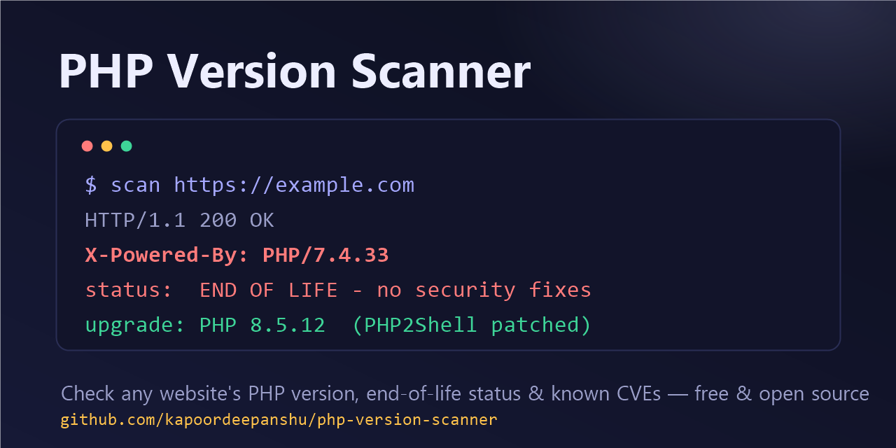

# PHP Version Scanner — Check Any Website's PHP Version, EOL & Security Status Online



**PHP Version Scanner** is a free, open-source tool that detects which **PHP version a website is running**, tells you whether that version is **end of life (EOL)**, matches it against **known PHP vulnerabilities (CVEs)** — including the critical **PHP2Shell remote code execution flaws** — and recommends the exact **secure PHP version to upgrade to**. Scan multiple URLs at once, right from your browser.

**Live demo:** https://php-version-scanner.vercel.app

---

## Why check your website's PHP version?

Running an outdated PHP version is one of the most common ways websites get hacked. Once a PHP branch reaches **end of life, it receives no security patches** — every vulnerability discovered afterwards stays exploitable forever. In October 2026, the **PHP2Shell** flaws (CVE-2026-109618 & CVE-2026-109619, both CVSS 9.2, unauthenticated RCE) were exploited in the wild within days of disclosure — and EOL branches will never get the fix.

## Features

- 🔍 **Detect the PHP version** of any public website from its HTTP response headers (`X-Powered-By`, `Server`)
- 📋 **Scan multiple URLs at once** — paste up to 10 links, one per line
- ⏳ **End-of-life check** — see whether the detected version is actively supported, security-only, or EOL
- 🛡️ **CVE matching** — flags known vulnerabilities the detected version is exposed to, including PHP2Shell
- ⬆️ **Upgrade recommendation** — the exact latest secure patch and the recommended branch (PHP 8.4 / 8.5)
- 📈 **Visual support timeline** — animated chart of every PHP branch's active / security / EOL phases
- 🧩 **"Not detected" explained** — tells you *why* a version can't be read (Cloudflare/CDN/WAF stripping headers, `expose_php=Off`, non-PHP stack) and detects when PHP is present but hiding its version (`PHPSESSID`)
- 🔧 **Built-in guides** — collapsible step-by-step instructions to upgrade PHP safely (cPanel, WHM/EasyApache, Plesk, Ubuntu VPS, AWS EC2/Elastic Beanstalk, Docker) and harden your setup
- 🔄 **Always current** — latest patch versions refresh live from php.net
- ⚡ **One-click deploy to Vercel** — static frontend + two serverless functions, zero build step

## How it works

1. You enter one or more website URLs.
2. A serverless function (`/api/scan`) sends a single normal GET request to each site and reads the **response headers only** — nothing intrusive, no crawling.
3. If the server exposes `X-Powered-By: PHP/x.y.z` (the PHP default, `expose_php=On`), the version is parsed and compared against the official PHP release lifecycle and a curated CVE list.
4. You get a verdict: **secure / outdated patch / security-fixes-only / end of life / not detected**, plus the exact version to upgrade to and how to do it.

## Frequently asked questions

### How do I check which PHP version a website is using?

Enter the website URL in the scanner and press **Scan PHP version**. The tool inspects the site's HTTP response headers and shows the detected PHP version, its support status, and the recommended upgrade — no server access needed.

### What is PHP2Shell (CVE-2026-109618 / CVE-2026-109619)?

PHP2Shell is the name for two **critical unauthenticated remote code execution vulnerabilities in PHP core**, both rated **CVSS 9.2**, disclosed in October 2026 and exploited in the wild. Fixed versions: **PHP 8.5.12, 8.4.27, 8.3.36, 8.2.35** (released 2026-10-21). After patching you must restart PHP-FPM or your web server. End-of-life branches (8.1 and older) will not receive an official fix.

### Which PHP versions are end of life in 2026?

PHP **8.1 and everything older** (8.0, 7.x, 5.x) is already EOL. **PHP 8.2** reaches EOL on **December 31, 2026**. PHP 8.3 gets security fixes until the end of 2027. **PHP 8.4 and 8.5 are the actively supported versions.**

### Why can't the scanner detect my site's PHP version?

Usually because `expose_php = Off` is set (a recommended hardening step), a CDN/WAF such as **Cloudflare, CloudFront, Akamai or Sucuri** strips origin headers, the web server removes `X-Powered-By`, or the site doesn't run PHP. **Not detected ≠ not vulnerable** — verify the real version in your hosting panel.

### Which PHP version should I upgrade to?

**PHP 8.5** (supported until Dec 31, 2029) or **PHP 8.4** (until Dec 31, 2028), at patch level **8.5.12 / 8.4.27 or later** so the PHP2Shell fixes are included.

## Deploy your own

```bash
# clone and deploy to Vercel in under a minute
git clone https://github.com/kapoordeepanshu/php-version-scanner.git
cd php-version-scanner
npx vercel
```

No environment variables, no database, no build step.

### Project structure

```
├── index.html        # the whole UI (Framer Motion vanilla build for animation)
├── api/scan.js       # serverless: fetches a URL, inspects headers, SSRF-guarded
├── api/releases.js   # serverless: live latest-patch data from php.net, cached 12h
└── social-preview.png
```

## Need a PHP upgrade done for you?

If you want your **PHP version upgraded** — and your website made fully **compatible with the latest PHP** — I can help. **WordPress, Laravel, OpenCart, Magento, CodeIgniter, custom PHP: all CMS and frameworks covered**, on shared hosting, VPS, AWS, cPanel/WHM or Plesk — from compatibility audit to zero-downtime migration.

- 🌐 Portfolio: https://kapoordeepanshu.github.io/
- 📧 Email: use the **Get in touch** button on the [live scanner](https://php-version-scanner.vercel.app)

## Security & privacy notes

- The scanner sends exactly one normal GET request per URL and reads headers only.
- Private/internal addresses (localhost, RFC-1918 ranges) are blocked server-side (SSRF guard).
- Only scan websites you own or are authorized to assess.

## License

[MIT](LICENSE) © [Deepanshu Kapoor](https://kapoordeepanshu.github.io/)

---

*Keywords: php version checker online, check website php version, detect php version of a website, php end of life checker, php eol dates 2026, php security scanner, php vulnerability scanner, php2shell, CVE-2026-109618, CVE-2026-109619, upgrade php version, php 8.5, wordpress php upgrade, laravel php compatibility*
